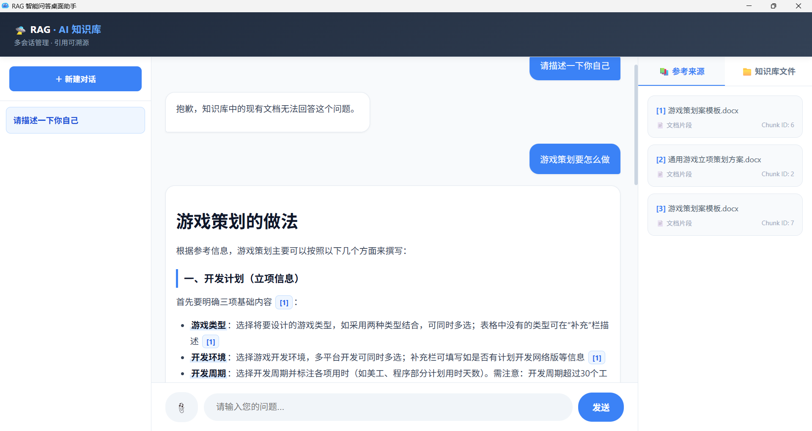

# 📚 RAG 智能知识库问答系统 (AI Knowledge Base)

基于 FastAPI + PostgreSQL(pgvector) + Redis 构建的企业级 RAG（检索增强生成）智能问答系统。支持多格式文档上传、异步解析、向量化、重排序以及 SSE 流式打字机输出。配备基于 PySide6 的原生桌面客户端。

## 🖼️ 界面预览

<div align="center">
  
  <p><i>智能问答界面：支持 Markdown 渲染、多会话管理和引用溯源</i></p>
</div>

## ✨ 核心特性

- **多格式文档解析**：支持 PDF、Word、Excel 的文本提取与切分。
- **异步任务解耦**：基于 Redis 队列与后台 Worker，实现文档解析与向量化的异步处理，接口秒级响应（202 Accepted）。
- **RAG 检索增强**：使用 `BAAI/bge-m3` 进行向量化，`pgvector` 进行相似度检索，并引入 `BAAI/bge-reranker-v2-m3` 重排序模型提升精度。
- **多轮对话与引用溯源**：支持上下文记忆，回答中附带 `[1]` `[2]` 引用徽章，右侧可点击高亮对应文档来源。
- **SSE 流式输出**：基于 Server-Sent Events 实现打字机效果，完美渲染 Markdown（标题、列表、代码块）。
- **安全与防幻觉**：基于 Rerank 分数的阈值拦截，知识库无相关内容时优雅拒绝，拒绝大模型编造。
- **原生桌面客户端**：基于 PySide6 + QtWebEngine 封装，支持原生文件选择器上传。

## 🏗️ 技术栈

- **前端**：HTML5 + JavaScript + PySide6
- **后端**：FastAPI (Python)
- **数据库**：PostgreSQL + pgvector
- **消息队列**：Redis
- **文档解析**：PyMuPDF, python-docx, pandas
- **大模型**：智谱 GLM-5.3-Flash (对话) + 硅基流动 BAAI/bge-m3 (向量化) + BAAI/bge-reranker-v2-m3 (重排序)

## 🚀 快速启动

本项目采用前后端分离架构，推荐使用 **Docker** + **Conda** 进行本地部署。

### 1. 环境准备
- 安装 [Docker Desktop](https://www.docker.com/products/docker-desktop/)（启动后确保小鲸鱼图标为绿色运行状态）。
- 安装 [Miniconda](https://docs.anaconda.com/miniconda/)（用于管理 Python 环境）。

### 2. 拉取代码
```bash
git clone https://github.com/C-Y-ggg/ai-knowledge-base.git
cd ai-knowledge-base
